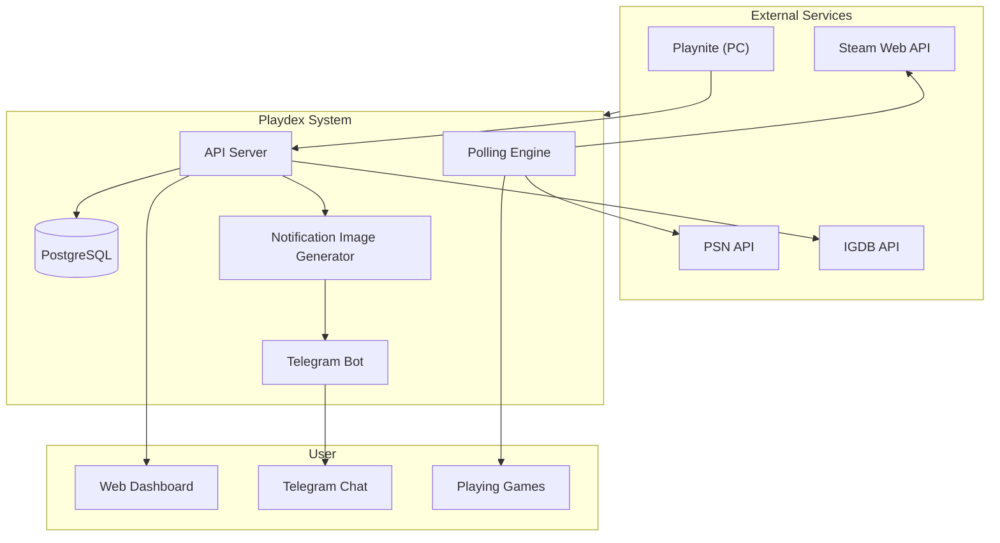
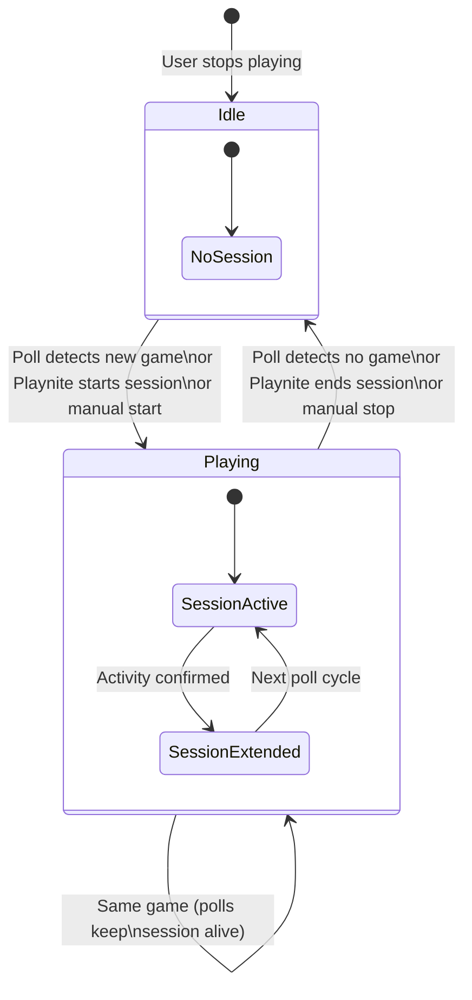
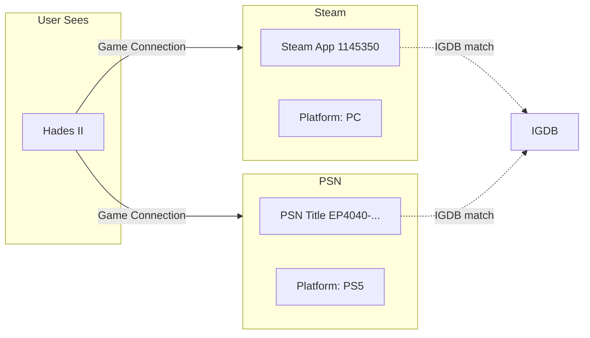
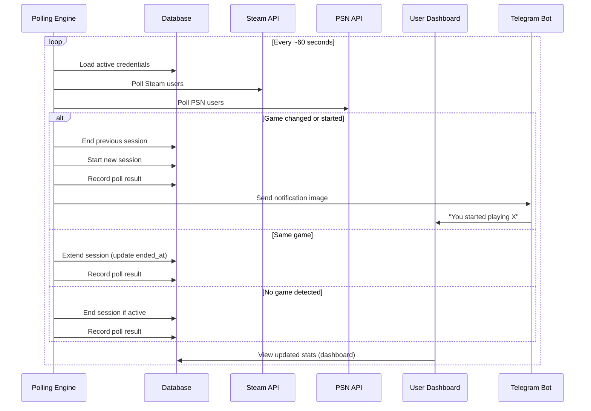
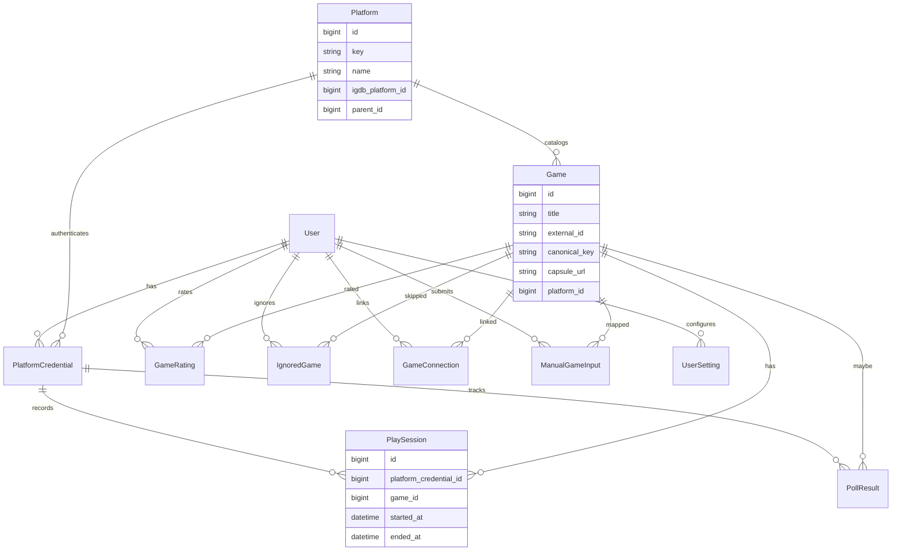
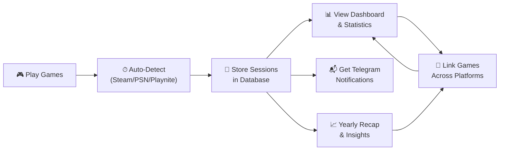

# Playdex — Business Overview

Playdex is a **multi-platform playtime tracker** that automatically records what you play, when, and for how long — across Steam, PlayStation, and PC (via Playnite).

---

## 1. How It Works (High-Level)

The system periodically polls Steam and PSN to detect what the user is playing, accepts session data from Playnite, and stores everything in a PostgreSQL database. Users view their play history on a web dashboard or receive Telegram notifications.

---

## 2. Play Session Lifecycle

### Session Sources

| Source | How It Works | Granularity |
|---|---|---|
| **Steam** | Polls `GetPlayerSummaries` every ~60s to get the currently played game | Auto, ~1 min |
| **PSN** | Polls PSN presence API to detect the current game | Auto, ~1 min |
| **Playnite** | PC app sends start/ping/end HTTP requests | Manual (per-session) |
| **Manual** | User starts/stops sessions via the web UI | Manual |

---

## 3. Multi-Platform Game Identity

The same game across platforms is linked via **game_connections** (user-level), and enriched with metadata from IGDB (covers, titles). This enables unified stats (e.g., "47 hours of Hades II" combining Steam + PS5 time).

---

## 4. Automated Polling Flow

---

## 5. Data Model (Core Business Entities)

The business entities center on **users** who own **platform credentials**. Each credential produces **play sessions** tied to **games** on specific **platforms**. Cross-platform identity is handled by **game connections** per user.

---

## 6. User Value Stream

The core value: **play once, track everywhere** — no manual logging, unified cross-platform history, and rich yearly retrospectives.

---

## 7. Tech Stack Summary

| Layer | Technology |
|---|---|
| Runtime | Bun |
| API Framework | Elysia |
| Database | PostgreSQL 16 (Kysely ORM) |
| Frontend | React + Vite + Tailwind CSS |
| Auth | JWT + bcrypt |
| Notifications | Satori → Resvg → Sharp → Telegram |
| Infrastructure | Docker, GitHub Actions → AWS ECR |
