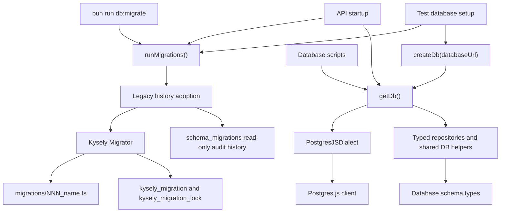

# Feature Design Document

## Overview

This feature replaces the API's direct Postgres.js query usage and custom `.sql`
migration runner with Kysely. The migration keeps Postgres.js as the driver through
the maintained `kysely-postgres-js` dialect, so connection behavior and PostgreSQL
runtime semantics remain stable while the application gains a typed database
boundary.

The implementation will:

- introduce a shared `Kysely<Database>` factory and singleton;
- model the current PostgreSQL schema with explicit Kysely table types;
- convert repository reads and writes to typed query builders;
- retain narrow, documented Kysely `sql` expressions for PostgreSQL features that
  are not clearly represented by query-builder methods;
- convert the 13 historical `.sql` files into immutable ordered TypeScript
  migration modules;
- automatically adopt the legacy `schema_migrations` history without replaying
  previously applied migrations;
- use the same migration runner at API startup, in the CLI command, and in tests;
- add a repository check that blocks direct Postgres.js imports and `.sql`
  migrations from returning.

The web application and API contract are outside the intended behavioral surface.
Existing response shapes, ordering, pagination, lock semantics, and database-backed
flows must remain unchanged.

## Research Findings

The design uses the following primary sources:

- [Kysely migrations documentation](https://www.kysely.dev/docs/migrations)
  documents ordered migration execution, immutable migration history, transactional
  migrations, and built-in locking for concurrent `migrateToLatest()` calls.
- [Kysely `Migrator` API](https://kysely-org.github.io/kysely-apidoc/classes/Migrator.html)
  exposes programmatic migration execution and per-migration results for startup,
  scripts, and test assertions.
- [Kysely `MigratorProps` API](https://kysely-org.github.io/kysely-apidoc/interfaces/MigratorProps.html)
  documents the configurable internal migration and lock tables. This design keeps
  Kysely's default internal tables separate from the legacy table.
- [Kysely `FileMigrationProvider` API](https://kysely-org.github.io/kysely-apidoc/classes/FileMigrationProvider.html)
  supports loading ordered TypeScript migration modules from a directory.
- [Kysely `sql` API](https://kysely-org.github.io/kysely-apidoc/interfaces/Sql.html)
  provides parameterized raw SQL fragments for the narrow cases that require
  PostgreSQL-specific expressions.
- [Kysely Postgres.js dialect](https://github.com/kysely-org/kysely-postgres-js)
  is maintained under the Kysely organization and accepts the existing Postgres.js
  client.
- [Postgres.js data transformation documentation](https://github.com/porsager/postgres#data-transformation)
  explains that PostgreSQL `bigint` values are returned as strings by default
  because the full range cannot be represented safely by JavaScript numbers.

## Architecture



The migration runner is deliberately separate from repository query conversion.
This keeps schema rollout behavior reviewable and testable while repositories move
to typed builders.

## Components and Interfaces

### Shared Kysely Database Boundary

Create `apps/api/src/common/db/database.ts` as the only module that imports
`postgres` and constructs clients. It replaces the public role of
`src/common/db/postgres.ts`.

The module exposes:

```ts
export type Db = Kysely<Database>;
export type DbExecutor = Kysely<Database> | Transaction<Database>;

export function createDb(databaseUrl: string, options?: CreateDbOptions): Db;
export function getDb(): Db;
export async function destroyDb(): Promise<void>;
```

`createDb()` constructs a Postgres.js client with the current notice filtering and
pool defaults, then wraps it in `PostgresJSDialect`. `getDb()` preserves the current
singleton behavior and reinitializes the singleton if `DATABASE_URL` changes.
Tests and scripts use `createDb()` so their lifetimes remain explicit.

No repository, service, test, or script imports `postgres` directly. Administrative
database creation remains a small helper in the database boundary because Kysely
cannot connect to a database before it exists.

### Typed Schema Contract

Create `apps/api/src/common/db/schema.ts` with a `Database` interface and one table
interface per application table. Use Kysely `Generated`, `ColumnType`,
`Selectable`, `Insertable`, and `Updateable` types where they express actual
database behavior.

The schema contract models driver output, not idealized domain types:

```ts
export type DbBigInt = string;
export type DbBigIntInput = string | number;

export type GeneratedDbBigInt = ColumnType<
  DbBigInt,
  DbBigIntInput | undefined,
  DbBigIntInput
>;
```

Foreign keys backed by `bigint` are also represented as strings when selected.
Repository return types normalize identifiers only when values cross into existing
domain models or JSON responses that require numeric IDs.

Create `apps/api/src/common/db/ids.ts` with a single checked conversion helper:

```ts
export function toDomainId(value: string | number, field: string): number;
```

The helper converts only positive safe integers and throws a descriptive error for
values that cannot be represented safely. This avoids an implicit global transform
that would change current Postgres.js behavior.

### Repository Conversion

Convert repositories to accept a `DbExecutor` where injection is useful and default
to `getDb()` at the existing boundary. Kysely transactions can pass their
`Transaction<Database>` executor into the same functions.

| Area | Conversion approach |
| --- | --- |
| `accounts` | Typed joins, filters, ordering, pagination, and aggregate selections. Keep narrow typed `sql` expressions for UTC date boundaries, interval calculations, and grouped statistics. |
| `admin` | Typed CRUD and filters. Keep a documented typed `sql` expression for the row-number window calculation and other PostgreSQL expressions where builder code would obscure intent. |
| `auth`, `settings`, `telegram` | Direct typed CRUD conversion. |
| `games`, `providers`, `recap` | Typed selects, inserts, joins, ordering, and aggregate expressions. |
| `manual`, `playnite`, `polling` | Typed transaction-aware writes and shared game upsert helper so lock behavior is implemented once. |

Create `apps/api/src/common/db/queries/games.ts` for the repeated game upsert
behavior currently implemented separately by polling, manual inputs, and Playnite
sync. The helper preserves:

- existing title when `title_locked` is true;
- existing image when `capsule_url_locked` is true;
- existing image when an incoming image is absent;
- existing provider identity and conflict behavior.

The helper accepts `DbExecutor`, which allows callers to keep transaction scope
without exposing the underlying driver.

Avoid broad generic repository abstractions. Most queries remain in the module
that owns their business behavior.

### Raw SQL Escape-Hatch Policy

Kysely query builders are the default. Kysely's parameterized `sql` tag is allowed
only for narrow expressions that the builder cannot express clearly, including:

- PostgreSQL date and interval functions;
- window functions and complex aggregate fragments;
- PostgreSQL advisory locking around legacy migration adoption;
- serial sequence alignment during seed operations;
- quoted database creation after strict identifier validation.

Each query-local escape hatch includes a short comment stating why a typed builder
is insufficient. Reusable expressions belong in
`apps/api/src/common/db/expressions.ts`.

Do not use driver-level tagged SQL outside the shared database boundary. Do not
interpolate user-controlled values into raw SQL strings. The only dynamic
identifier use is database creation, where a centralized helper validates and
quotes the identifier before execution.

### Migration Modules

Replace the 13 files under `apps/api/migrations/*.sql` with ordered TypeScript
modules:

```text
001_init.ts
002_poll_results.ts
...
013_add_game_title_lock.ts
```

Each file exports an `up(db: Kysely<unknown>)` function. Historical modules are a
faithful conversion of the existing SQL and become immutable after merge. Do not
invent historical `down()` behavior where a safe rollback contract does not
already exist. Future migrations use the same `NNN_slug.ts` convention and provide
`down()` when rollback is well-defined.

Use Kysely schema builders for tables, columns, constraints, indexes, and data
updates where supported. Retain narrow parameterized `sql` expressions for
PostgreSQL-specific operations such as the partial `chat_id` index and serial
sequence alignment.

The migration directory is resolved from a stable API-root path rather than the
process working directory. This keeps startup, CLI, Docker, and tests on the same
module set.

### Legacy Migration Adoption

Keep Kysely's default `kysely_migration` and `kysely_migration_lock` tables
separate from the existing `schema_migrations(version, applied_at)` table.
Overloading the legacy table would couple application code to Kysely internal
metadata shape.

Before calling `migrateToLatest()`, `runMigrations()` performs an adoption phase
under a PostgreSQL advisory lock:

1. Acquire a documented session-level advisory lock on a dedicated connection.
2. Detect whether the legacy `schema_migrations` table exists.
3. Read legacy versions in applied order and map `<name>.sql` rows to the matching
   `<name>.ts` historical modules.
4. Validate that every legacy row maps to a known historical migration and that
   applied rows form an ordered prefix. Unknown rows, missing predecessors, or
   duplicate history fail before schema changes.
5. If Kysely metadata is absent or empty, create and seed Kysely history entries
   for the validated legacy prefix without running their `up()` functions.
6. If both legacy and Kysely metadata exist, compare the mapped histories and fail
   before schema changes when they diverge.
7. Call Kysely `migrateToLatest()` so only pending modules execute.
8. Inspect every migration result and surface the failing migration and direction
   when an error is returned.
9. Release the advisory lock in `finally`.

Kysely's built-in migration lock protects normal canonical migration execution.
The outer advisory lock is still required because legacy history adoption occurs
before Kysely metadata is populated.

The legacy table remains read-only after adoption for auditability and deployment
compatibility. Kysely metadata becomes canonical for future migrations.

### Runtime, Scripts, and Tests

Update API startup to call the shared runner and then obtain `getDb()`. Pass the
Kysely database object into polling and Telegram integration points that currently
receive a Postgres.js client.

Update:

- `apps/api/scripts/migrate.ts`
- `apps/api/scripts/create-user.ts`
- `apps/api/scripts/update-user-password.ts`
- `apps/api/scripts/seed.ts`
- `apps/api/tests/helpers/db.ts`

Scripts create or obtain a Kysely instance and call `destroy()` in `finally`.
Database creation uses the centralized administrative helper.

`scripts/seed.ts` currently imports a missing `src/shared/db/queries` module. Its
conversion must use the new shared game helper or script-local typed operations so
the stale import is removed as part of the boundary cleanup.

Tests receive a Kysely database instance instead of a Postgres.js client. Fixture
setup and schema assertions use typed builders when practical and narrow Kysely
`sql` expressions for reset or catalog inspection operations.

### Repository Guard

Create `apps/api/scripts/check-db-boundary.ts` and invoke it from `bun run check`.
The script fails when:

- a `.sql` file exists under `apps/api/migrations`;
- a direct `postgres` import exists outside
  `apps/api/src/common/db/database.ts`;
- driver-level unsafe query execution is introduced outside the explicitly
  approved administrative helper;
- a migration does not follow the `NNN_slug.ts` convention.

The guard is intentionally simple and deterministic so it runs in local checks and
CI without a database.

## Data Models

### Application Tables

| Table | Role | Important typing details |
| --- | --- | --- |
| `users` | Account identity, Telegram linkage, admin state | Generated `bigint` ID, nullable `chat_id`, generated timestamps |
| `platforms` | Canonical platform catalog | Generated `bigint` ID, unique platform key |
| `platform_credentials` | User credentials per platform | Generated `bigint` ID, `bigint` foreign keys, active state |
| `games` | Canonical game catalog | Generated `bigint` ID, nullable capsule URL, title and capsule lock flags |
| `play_sessions` | Recorded play activity | Generated `bigint` ID, `bigint` foreign keys, timestamps and duration |
| `poll_results` | Polling result history | Generated `bigint` ID, user/platform linkage and poll timestamps |
| `manual_game_inputs` | User-entered game sessions | Generated `bigint` ID and `bigint` foreign keys |
| `ignored_games` | Per-user ignored games | User/game key pair |
| `game_ratings` | Per-user ratings | User/game key pair and constrained rating |
| `user_settings` | Per-user settings | User key and settings values |
| `game_connections` | Connected game identities | Generated `bigint` ID and provider/game linkage |

`schema.ts` is the source of truth for selected, inserted, and updated row shapes.
Computed rows and aliased selections receive explicit result types close to the
query that produces them.

### Migration Metadata

| Table | Ownership | Role |
| --- | --- | --- |
| `schema_migrations` | Legacy runner | Read-only adoption input and audit history |
| `kysely_migration` | Kysely | Canonical applied migration history |
| `kysely_migration_lock` | Kysely | Built-in migrator serialization |

## Error Handling

| Failure | Behavior |
| --- | --- |
| Missing `DATABASE_URL` | Preserve the current startup failure with a clear configuration error. |
| Unsafe `bigint` conversion | Throw a descriptive boundary error naming the field before a lossy value reaches domain code. |
| Legacy history contains unknown or out-of-order rows | Abort before metadata seeding or schema mutation. Report the conflicting versions. |
| Legacy and Kysely metadata diverge | Abort before migration execution. Report both histories for operator recovery. |
| TypeScript migration fails | Preserve transaction rollback, report the migration name and direction, and leave it unapplied. |
| Concurrent startup migration attempts | Serialize adoption with advisory locking and normal Kysely migration execution with Kysely's lock table. |
| Database creation fails | Surface the administrative connection error and always close the temporary client. |

## Testing Strategy

### Migration Tests

Rewrite `apps/api/tests/migrations.test.ts` around TypeScript modules and the shared
runner. Cover:

- empty database applies all historical modules in order;
- a second run is a no-op;
- legacy `schema_migrations` history is adopted without replaying applied modules;
- a legacy prefix with pending modules adopts the prefix and executes only the
  pending modules;
- unknown, duplicate, or out-of-order legacy metadata fails before schema changes;
- diverging legacy and Kysely metadata fails closed;
- a failing TypeScript migration rolls back and remains unapplied;
- concurrent migration attempts apply each module exactly once.

### Persistence and Repository Tests

Run the existing API test suite after replacing fixture access with Kysely. Preserve
coverage for:

- auth and user persistence;
- polling, manual entry, and Playnite ingestion;
- admin reads and writes;
- account statistics and recap aggregation;
- title and capsule lock behavior during game upserts;
- settings, provider, and Telegram flows.

Add focused tests for `toDomainId()` safe conversion and the shared game upsert
helper.

### Static Boundary Tests

Run `bun run check` to execute the repository guard, lint, TypeScript validation,
and formatting checks. The guard proves that direct Postgres.js imports and `.sql`
migrations do not return after the conversion.

## CICD Integration Strategy

Update `apps/api/package.json` to add `kysely` and `kysely-postgres-js`, and include
the database-boundary guard in `bun run check`.

The existing GitHub Actions API check continues to run without PostgreSQL for
static validation. The API test job continues to use its PostgreSQL service and
now exercises:

- clean TypeScript migration application;
- legacy adoption behavior;
- the converted repository suite.

The Docker image already copies `migrations/` and the API source. After conversion,
that directory contains TypeScript modules loaded by Bun at startup. No new
container service or deployment step is required.

Update `README.md` to document:

- `bun run db:migrate`;
- startup migration behavior;
- automatic legacy history adoption;
- the immutable `NNN_slug.ts` migration naming and ordering convention;
- the rule that future schema changes use Kysely TypeScript migrations rather than
  `.sql` files.

## Requirement Traceability

| Requirement | Design coverage |
| --- | --- |
| Typed Kysely database boundary | Shared database boundary, typed schema contract, repository conversion |
| Explicit bigint and row typing | Typed schema contract, checked `toDomainId()`, explicit computed-row types |
| Preserve application behavior | Repository conversion table, shared game upsert semantics, persistence test suite |
| Convert historical migrations | Ordered immutable TypeScript migration modules |
| Fresh database initialization | Kysely migrator with TypeScript modules |
| Existing database adoption | Advisory-locked legacy adoption flow |
| Fail closed on inconsistent metadata | Adoption validation and error-handling table |
| Exactly-once and concurrent migration safety | Outer advisory lock plus Kysely migration lock |
| Shared startup and CLI workflow | Runtime, scripts, and tests integration |
| Prevent raw SQL and `.sql` regression | Repository guard and raw SQL escape-hatch policy |
| Document future workflow | README changes and migration naming convention |

## Design Decisions

### Keep Postgres.js as the Driver

Using `kysely-postgres-js` narrows the change to query construction and migration
management. Replacing the driver at the same time would increase behavioral risk
without contributing to the requirements.

### Keep Legacy and Kysely Metadata Separate

The legacy table has a different schema and historical purpose. Treating it as
read-only adoption input avoids coupling Kysely internals to application-specific
history while preserving operator visibility.

### Serialize Adoption Before Using the Built-In Migrator Lock

Kysely's lock protects normal migration execution, but it cannot protect a
pre-migration metadata bootstrap that has not yet populated Kysely history.
An outer PostgreSQL advisory lock closes that race with a small, isolated
PostgreSQL-specific expression.

### Model Driver Output Before Domain Conversion

Postgres.js returns `bigint` values as strings. Modeling that fact in `schema.ts`
keeps database types honest and makes numeric conversion deliberate, checked, and
reviewable.

### Centralize Only Repeated Business-Sensitive Upserts

The game upsert logic is duplicated across polling, manual inputs, and Playnite and
contains lock semantics that must remain consistent. Centralizing that helper
reduces risk. Other repository queries remain local to avoid creating a generic
abstraction layer without a concrete need.
