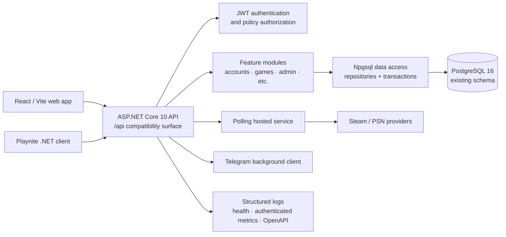

# Feature Design Document

## Overview

Playdex will replace its Bun/Elysia API with an ASP.NET Core 10 minimal API while
retaining the React/Vite web client, PostgreSQL 16 database, and Playnite client.
The migration is an API/runtime replacement, not a product redesign: the public
`/api` HTTP contract, existing schema, data, JWT behavior, polling, Telegram
integration, OpenAPI documentation, and authenticated metrics remain compatible.

The .NET 10 choice is deliberate: it is the current LTS release and is supported
through November 2028 ([Microsoft support policy](https://learn.microsoft.com/en-us/dotnet/core/releases-and-support)).
ASP.NET Core minimal APIs provide first-party OpenAPI document generation
([Microsoft OpenAPI overview](https://learn.microsoft.com/en-us/aspnet/core/fundamentals/openapi/overview)).

The migration will use a strangler cutover:

1. build and verify a .NET API alongside the current service against an isolated
   database copy;
2. run HTTP compatibility tests against both implementations;
3. switch the deployment target to the .NET image only after parity and
   operational checks pass;
4. retain the prior image and an explicit rollback procedure through the agreed
   stabilization period.

The TypeScript API is removed only after the .NET service is the production
primary backend and the rollback window has closed. The web app will need only a
configuration-level change if its base URL remains unchanged.

## Architecture

The .NET API will be a modular monolith. Each existing API module maps to a
feature area containing endpoints, application services, request/response
contracts, and repository access. This keeps ownership aligned with the current
service without prematurely splitting the deployment into microservices.



### Runtime and deployment

Create a new solution under `apps/api-dotnet/`:

```text
apps/api-dotnet/
  Playdex.Api/                 # ASP.NET Core host and feature modules
  Playdex.Api.Tests/           # unit and HTTP integration tests
  Playdex.ContractTests/       # cross-runtime compatibility fixtures/tests
  Playdex.sln
  Dockerfile
```

`Playdex.Api` targets `net10.0`, uses the .NET generic host, and listens on the
existing application port (3000 inside the container). A multi-stage Docker build
publishes a non-root production image. `docker-compose.yml` changes the `app`
service build context from `apps/api` to `apps/api-dotnet` while retaining the
service name, port, environment variable names, database service, and web UI
base URL.

Configuration uses standard .NET configuration providers in this precedence:
`appsettings.json`, `appsettings.{Environment}.json`, environment variables, and
command-line arguments. A typed `PlaydexOptions` object validates the required
database connection string, polling interval bounds, JWT settings, CORS origins,
and optional integration credentials at startup. Existing environment variable
names remain the external contract; configuration binding maps them into the
typed options.

## Components and Interfaces

### HTTP compatibility layer

Use ASP.NET Core minimal API route groups under `/api`. Endpoint groups retain
the existing paths, methods, path/query names, authentication requirements,
status codes, response envelope shapes, JSON property names, pagination and sort
semantics. The initial groups are:

| Group | Existing contract |
| --- | --- |
| root and auth | `/api`, login, refresh, and current-user endpoints |
| accounts | accounts, sessions, daily/current sessions, statistics |
| games | game lookup, connections, ignored games, and ratings |
| manual and Playnite | manual-entry workflows and Playnite session ingestion |
| providers and polling | provider status and provider-key flows |
| settings and recap | user settings and yearly recap views |
| admin | sessions, credentials, provider platform status, and games |
| operations | authenticated `/api/metrics`, `/swagger`, and `/swagger/json` |

Request DTOs use explicit JSON names and validation rules rather than relying on
CLR naming conventions. Response DTOs are separate from database entities so
schema changes cannot accidentally alter the wire contract. The serializer uses
`System.Text.Json` with an explicit camel-case policy, UTC ISO-8601 date/time
formatting, and converters where the current API has special numeric or nullable
semantics.

An `AppProblem` exception/result abstraction maps domain validation, not-found,
conflict, authentication, and unexpected errors to the existing error response
shape. A single exception handler logs unexpected errors with a correlation ID;
the client receives only the safe error contract.

### Authentication, authorization, and CORS

Implement JWT bearer authentication with the existing signing secret, issuer and
audience behavior where currently configured, claim names, token TTL, and refresh
token/session persistence rules. Endpoint policies replace the current Elysia
authentication middleware; `admin` requirements are represented as an explicit
role/claim policy. Password hashing remains bcrypt-compatible so existing hashes
continue to authenticate.

Configure CORS from the existing comma-separated `CORS_ORIGINS` setting. Empty
configuration denies cross-origin browser access and wildcard origins are
rejected, matching current behavior. HTTPS redirect and production security
headers are enabled at the reverse-proxy/application boundary without changing
the existing public origin.

### Application modules and background work

Each feature is organized as `Features/<Feature>/Endpoints`, `Contracts`,
`Services`, and `Data`. Services contain business rules; repositories contain
parameterized database access; endpoints perform HTTP binding and return DTOs.
Avoid a generic repository abstraction because current queries are feature- and
report-specific.

Replace the API process's startup polling loop with a `BackgroundService`:

- it validates migrations and required dependencies before reporting readiness;
- it loads active polling accounts each cycle and executes existing Steam/PSN
  provider behavior;
- it preserves interval clamping, poll success/failure counters, and cancellation
  on graceful shutdown;
- transient provider failures are logged per account/platform and do not stop the
  next cycle.

Telegram notification and bot processing are hosted services. The notification
image renderer is ported to a .NET-compatible renderer or replaced only after
visual-output fixture comparisons demonstrate parity. Long-running work always
observes `CancellationToken` so container termination drains safely.

### Data access and migrations

Use `NpgsqlDataSource` as the shared, configured PostgreSQL connection pool and
feature-scoped repositories for commands and reads. Entity Framework Core with
the Npgsql provider models writes, relationships, and transactional aggregates;
parameterized Npgsql commands are permitted for existing report queries,
PostgreSQL-specific functions, and high-fidelity bulk/upsert behavior that would
be less clear in LINQ. Package versions will be pinned to the .NET 10-compatible
Npgsql/EF Core release selected during implementation. EF Core lists
`Npgsql.EntityFrameworkCore.PostgreSQL` as the PostgreSQL provider
([provider documentation](https://learn.microsoft.com/en-us/ef/core/providers/)).

The existing PostgreSQL schema is authoritative. The initial .NET EF model is
scaffolded/mapped to that schema but does **not** generate an initial schema or
replay prior migrations. Existing Kysely history and tables remain untouched.

Schema changes after cutover use a C# migration runner with ordered, immutable
`NNN_slug` migration identifiers and a dedicated `dotnet_schema_migrations`
metadata table. The runner acquires the same PostgreSQL advisory lock pattern as
the current system, validates ordered history, records success atomically with
the schema change, and executes at startup plus a `dotnet run -- migrate` command.
It never rewrites `schema_migrations` or Kysely metadata. Each new migration
declares whether rollback is supported; release documentation states the required
backup/recovery action for irreversible changes.

### Operations and documentation

Use `ILogger` with JSON console output and scopes containing a correlation ID,
HTTP method/path/status, feature name, and safe diagnostic fields. Secrets,
authorization headers, cookies, tokens, raw passwords, and sensitive record
contents are never logged.

Expose:

- `/health/live`: process liveness with no external dependency check;
- `/health/ready`: readiness after options validation, migrations, database
  connectivity, and hosted-service initialization;
- the existing authenticated `/api/metrics` contract, backed by a singleton
  metrics collector;
- `/swagger/json` and `/swagger`, generated from endpoint metadata and checked
  against the pre-migration OpenAPI document.

Separate liveness and readiness is intentional: ASP.NET Core health checks
support tagging/filtering probes for this distinction
([Microsoft health-check guidance](https://learn.microsoft.com/en-us/aspnet/core/host-and-deploy/health-checks)).

## Data Models

Database entities map one-to-one to the existing PostgreSQL tables, constraints,
and column names. The .NET model preserves PostgreSQL types deliberately:

| PostgreSQL concern | .NET representation |
| --- | --- |
| `bigint` identifiers | `long` internally; explicit contract conversion only where the current API exposes a number/string |
| timestamps | `DateTimeOffset` in UTC |
| nullable columns | nullable reference/value types, explicitly reflected in DTOs |
| JSON values | `JsonDocument` or typed converter only after contract verification |
| enums/statuses | constrained enum/value objects with database conversion |

Create mapping tests for every entity that includes identifiers, timestamps,
nullable fields, foreign keys, lock flags, and provider-specific columns. New
EF migrations are not used to retrofit or rename legacy tables.

## Error Handling

The API distinguishes errors without leaking implementation detail:

| Condition | Client behavior | Operational behavior |
| --- | --- | --- |
| invalid request | preserve existing 4xx status and validation body | debug/warn event without secrets |
| unauthenticated/forbidden | preserve existing 401/403 response | security-relevant info event |
| absent resource | preserve existing 404 body | debug/info event |
| domain conflict | preserve existing 409 response | warning with safe entity context |
| database/provider timeout | controlled existing-compatible 5xx response | error log, trace/correlation ID, readiness degradation as applicable |
| unexpected exception | generic existing-compatible 500 body | structured error with exception details only in logs |

Database transactions cover multi-table writes such as session creation/updating,
provider sync, and game upserts. A transaction failure rolls back the entire
operation. Database startup failure prevents readiness; transient poll/provider
failures do not terminate the API process.

## Testing Strategy

Testing proves parity before cutover rather than merely proving the new code
works in isolation.

1. **Unit tests:** service rules, DTO validation, token behavior, error mapping,
   configuration validation, and polling scheduling.
2. **Repository integration tests:** run against PostgreSQL 16 in containers;
   apply the current schema and exercise reads, joins, writes, locks, pagination,
   transaction rollback, and data-type mappings.
3. **HTTP integration tests:** use `WebApplicationFactory` and a real isolated
   PostgreSQL database; assert every existing endpoint's accepted requests,
   response status/body/headers, error cases, authorization, CORS, OpenAPI, and
   metrics behavior.
4. **Differential contract tests:** execute a shared fixture corpus against the
   Bun API and .NET API on identical seeded databases, normalize only explicitly
   variable fields (timestamps, tokens, correlation IDs), then compare results.
5. **Background integration tests:** use fake clocks and provider/Telegram
   adapters to verify polling, retry/cancellation, notification dispatch, and
   disabled-credential behavior.
6. **Migration tests:** verify historical database adoption, no mutation of
   Kysely/legacy history, ordered new migration execution, lock contention, and
   rollback documentation for irreversible changes.
7. **Release rehearsal:** deploy the .NET image to a production-like environment,
   run smoke checks, exercise rollback to the Bun image, and verify that data is
   readable and unchanged afterwards.

## CICD Integration Strategy

The pipeline adds a .NET build/test lane while the Bun API remains the reference:

1. restore pinned NuGet packages, format/lint/analyze, and build the solution;
2. run unit, repository, and HTTP integration tests against PostgreSQL 16;
3. start both API implementations with the same fixture database and run
   differential contract tests;
4. generate OpenAPI JSON and fail on unapproved contract differences;
5. build and scan the production container image;
6. publish a release candidate only when all checks pass.

The deployment runbook first backs up the database, applies any pending C# schema
migrations under the advisory lock, starts the .NET container, waits for
`/health/ready`, runs authenticated smoke checks, and then directs traffic to it.
Rollback restores the former Bun image/configuration. If a release contains an
irreversible schema migration, rollback follows the migration-specific backup and
recovery procedure rather than attempting an unsafe automatic down migration.
