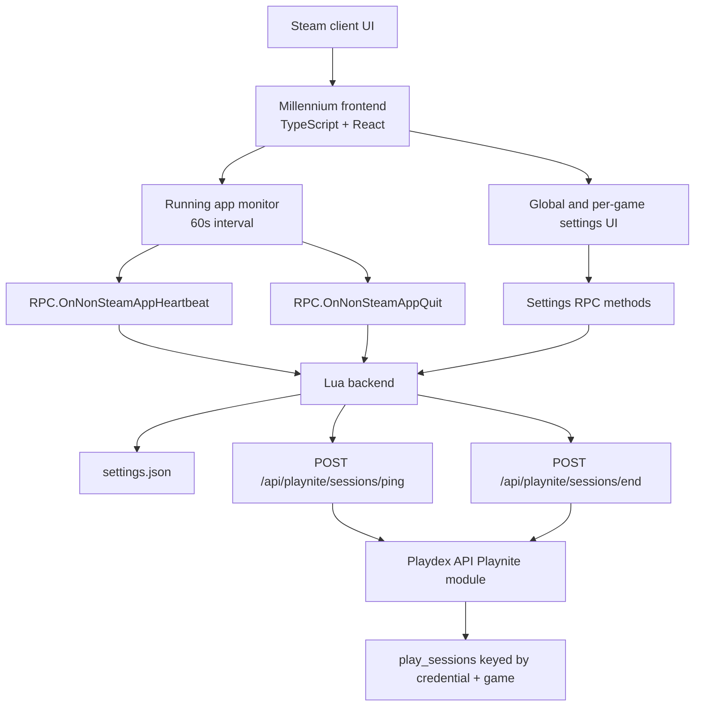

# Feature Design Document

## Overview

This feature rewrites the Playdex Millennium extension from scratch with a Lua
backend while keeping the Steam UI frontend behavior familiar. The rewritten
extension uses only two Playdex session endpoints:

- `POST /api/playnite/sessions/ping`
- `POST /api/playnite/sessions/end`

`ping` creates or refreshes an active session. `end` closes the active session for
the same API key and game identity. This means the extension and API both treat a
session as scoped by `apiKey + gameProvider + gameId`, which allows multiple
non-Steam apps to be tracked at the same time under one Playdex account.

The implementation will:

- replace the Python backend under `apps/millenium/backend` with Lua modules;
- keep the plugin identity as `playdex-dev` for dev installs and `playdex` for
  production packages;
- keep the TypeScript/React frontend unless a later implementation step chooses a
  more targeted rewrite;
- remove the launch/start session path from the extension;
- update the Playdex API so `/end` accepts game identity and closes only the
  matching active session;
- preserve global API key, per-game API key override, and per-game custom Steam
  game ID settings;
- add focused tests for Lua backend logic and API multi-session behavior.

## Research Findings

The design uses these sources and local findings:

- [Millennium plugin config documentation](https://docs.steambrew.app/plugins/structure/config)
  describes `plugin.json`, `useBackend`, `backend`, `frontend`, and
  `backendType`, including Lua and Python backend modes.
- [Millennium file structure documentation](https://docs.steambrew.app/plugins/structure/file-structure)
  documents the expected plugin layout, including frontend and backend entry
  files.
- [Millennium Lua API documentation](https://docs.steambrew.app/plugins/lua/millennium)
  documents Lua backend startup, `millennium.ready()`, and logging helpers.
- [Millennium Lua HTTP documentation](https://docs.steambrew.app/plugins/lua/http)
  documents the Lua HTTP module used for Playdex API requests.
- [Millennium Lua JSON documentation](https://docs.steambrew.app/plugins/lua/cjson)
  documents the bundled JSON support used for settings and request bodies.
- The current extension in `apps/millenium` stores settings in plugin-local
  `settings.json`, monitors `Steam.UIStore.RunningApps`, filters non-Steam apps
  with `0x80000000`, injects a Playdex app properties page, and communicates with
  the backend through Millennium RPC methods.
- The current API module under `apps/api/src/modules/playnite` already has a
  `ping` endpoint that can start or refresh sessions, but its active-session
  logic is currently one active session per Playnite credential. That must change
  for concurrent non-Steam sessions.

## Architecture



The frontend owns Steam UI integration and app lifecycle detection because the
required Steam objects are available in the browser context. The Lua backend owns
settings persistence, payload normalization, authentication selection, and HTTP
requests. The API owns session semantics.

This split keeps Steam-specific patching in the same layer as the existing
extension while moving all native backend behavior away from Python.

## Components and Interfaces

### Plugin Package

`apps/millenium/plugin.json` will be updated for a Lua backend:

```json
{
  "name": "playdex",
  "common_name": "Playdex",
  "description": "Track playtime for non-Steam games",
  "version": "1.2.0",
  "useBackend": true,
  "backend": "backend/main.lua",
  "frontend": "frontend",
  "backendType": "lua"
}
```

The development script will temporarily build or copy with `name:
"playdex-dev"` and `common_name: "Playdex (dev)"`, then restore the production
manifest before finishing. The production build keeps `playdex`.

### Frontend Runtime

Keep these frontend modules, but adjust the lifecycle contract:

| Module | Design |
| --- | --- |
| `frontend/index.tsx` | Register plugin settings, app properties patch, and running app monitor. Remove calls to `RPC.OnNonSteamAppLaunch`. |
| `frontend/running-apps.ts` | Track running app ids with maps for ping and quit callbacks. On first observation of an eligible app, send a ping immediately, then send pings every 60 seconds while it remains running. |
| `frontend/rpc.ts` | Keep settings RPC methods. Remove or stop using `OnNonSteamAppLaunch`. Route heartbeat calls to Lua-backed `RPC.OnNonSteamAppHeartbeat`. |
| `frontend/app-properties.tsx` | Continue adding the Playdex app properties page only for non-Steam app ids. |
| `frontend/components/playdex-game-settings.tsx` | Preserve custom game id and optional API key override UI. |

The monitor continues to use `Steam.UIStore.RunningApps`. Apps with `appid <
0x80000000` are ignored. The monitor keeps an `inFlight` guard so a slow RPC or
Steam UI read cannot overlap with the next polling cycle.

The monitor should call `forceFakeLocationChange()` after successful pings and
per-game settings saves to preserve the current UI refresh behavior.

### Lua Backend

Create a small Lua backend with explicit modules:

```text
backend/
  main.lua
  rpc.lua
  playdex.lua
  settings.lua
  game_identity.lua
  http_client.lua
```

`main.lua` loads the modules, initializes settings, registers RPC methods, calls
`millennium.ready()` promptly, and logs backend load/unload events.

`rpc.lua` exposes the Millennium server methods expected by the frontend:

```lua
RPC.OnNonSteamAppHeartbeat(payload_json)
RPC.OnNonSteamAppQuit(payload_json)
RPC.OnApiKeyFieldChange(payload_json)
RPC.OnGameApiKeyFieldChange(payload_json)
RPC.GetApiKey(payload_json)
RPC.GetGameApiKey(payload_json)
RPC.SetGameId(payload_json)
RPC.GetGameId(payload_json)
```

Each method decodes JSON, validates required fields, calls the relevant domain
function, and returns JSON for read methods. Invalid RPC payloads are logged and
fail gracefully.

`playdex.lua` implements high-level operations:

```lua
ping_session(app_name)
end_session(app_name)
set_api_key(key, app_name_or_nil)
get_api_key(app_name_or_nil)
set_game_id(app_name, game_id)
get_game_id(app_name)
```

`game_identity.lua` resolves outbound API identity:

1. Look up a configured `games[appName].gameId`.
2. If none exists, parse a trailing ` [12345]` suffix from the app display name.
3. If no id exists, return `nil` so the caller skips the API request.
4. Return `{ gameTitle, gameId, gameProvider = "steam" }`.

The title should be the cleaned display name when parsing a bracketed id. For a
configured custom id, use the app display name with any trailing bracketed id
removed for consistency.

`http_client.lua` posts JSON to the Playdex API:

```lua
post_session_event("ping", api_key, game_identity)
post_session_event("end", api_key, game_identity)
```

It sets `Authorization`, `Content-Type`, and `Accept` headers. Failed responses,
timeouts, and thrown HTTP errors are caught and logged; they do not crash the
plugin.

### Settings Persistence

`settings.lua` stores settings in plugin-local `settings.json`:

```json
{
  "api_key": "global key",
  "games": {
    "Game Name": {
      "gameId": "730",
      "api_key": "optional override"
    }
  }
}
```

Reads:

- missing file returns empty settings;
- invalid JSON returns empty settings and logs a warning;
- missing nested objects are normalized lazily.

Writes:

- trim incoming string values before assignment;
- preserve intentionally empty strings;
- write to a temporary file in the plugin directory and rename/replace it to
  avoid partially written JSON where Lua file APIs allow it;
- return success/failure to RPC callers so the UI can show `Saved` or `Failed`.

### Playdex API Changes

The extension change requires the API to support concurrent active sessions under
one Playnite credential.

Update `apps/api/src/modules/playnite/playnite.handlers.ts`:

- keep `parseGamePayload` as the shared validator for `ping` and `end`;
- change `endPlayniteSessionsHandler` to accept a JSON body and parse game
  identity;
- return `400` when end payload is missing `gameTitle`, `gameId`, or
  `gameProvider`;
- keep `401` behavior for missing or invalid API keys.

Update `apps/api/src/modules/playnite/playnite.service.ts`:

```ts
export type PlayniteSessionEndInput = {
  apiKey: string;
  gameTitle: string;
  gameId: string;
  gameProvider: PlayniteGameProvider;
};
```

`pingSession()` will:

1. Resolve the Playnite credential by API key.
2. Normalize and upsert the game.
3. End timed-out active Playnite sessions for the credential.
4. Fetch the active session for `platformCredentialId + gameId`.
5. Touch that session if present; otherwise insert a new active session.
6. Never end a different active game solely because this game pinged.

`endSessions()` will:

1. Resolve the Playnite credential by API key.
2. Normalize and upsert the game.
3. End only active sessions for `platformCredentialId + gameId`.
4. Return the number and details of sessions ended.

Update `apps/api/src/modules/playnite/playnite.repository.ts`:

- add `fetchActiveSessionForCredentialAndGame(credentialId, gameId, db)`;
- add `endActiveSessionsForCredentialAndGame(credentialId, gameId, endedAt, db)`;
- stop using `endActiveSessionsForCredentialExceptGame` in `pingSession`;
- keep timed-out cleanup by credential so stale sessions are still closed.

Remove the live-session `/start` route from the Playdex API surface during this
change. Any existing client or test that starts sessions through `/start` must be
updated to use `/ping`, because `ping` is now the canonical start-or-refresh
operation.

## Data Models

### Extension Settings

| Field | Type | Notes |
| --- | --- | --- |
| `api_key` | string | Global fallback API key. Empty string is allowed. |
| `games` | object | Map keyed by Steam app display name. |
| `games[appName].gameId` | string | Custom Steam game id override. Empty string clears override. |
| `games[appName].api_key` | string | Per-game API key override. Empty string falls back to global. |

### Session Event Payload

Both `ping` and `end` send the same request body:

```json
{
  "gameTitle": "Hades",
  "gameId": "1145360",
  "gameProvider": "steam"
}
```

Headers:

```text
Authorization: Bearer <api key>
Content-Type: application/json
Accept: application/json
```

The extension currently skips requests that cannot resolve a Steam game id, so
`gameProvider` will be `steam` for extension-generated requests. The API may keep
accepting `unknown` for compatibility with existing Playnite flows.

### API Active Session Identity

The logical active session key becomes:

```text
platformCredentialId + gameId + ended_at is null
```

No schema change is required for this behavior because `play_sessions` already has
`platform_credential_id`, `game_id`, and `ended_at`. The change is in repository
query predicates and service behavior.

## Error Handling

| Failure | Behavior |
| --- | --- |
| Lua backend cannot load settings | Log warning, continue with empty settings, call `millennium.ready()`. |
| Settings save fails | Return failure through RPC, keep in-memory value only if the caller can surface `Failed`. |
| Invalid RPC JSON | Log route and parse error, return nil or an error payload without throwing through Millennium. |
| Missing app display name | Skip ping/end and log missing identity. |
| Missing API key | Skip ping/end and log missing authentication. |
| Missing game id | Skip ping/end and log missing game identity. |
| HTTP failure | Log status or error text and continue monitoring. |
| API rejects `/end` body | Log the non-success response; the next ping/end cycle may retry according to normal lifecycle events. |
| Steam UI internals unavailable | Wait before patching app properties; avoid applying a partial patch. |
| Plugin reload | Clear monitor interval and unpatch app properties to avoid duplicate callbacks. |

## Testing Strategy

### Lua Backend Tests

Use the smallest practical Lua test runner available in the repository or add a
simple script-based test harness that can run without Steam. Cover:

- bracketed game id parsing;
- configured game id overriding parsed id;
- cleaned `gameTitle` behavior;
- settings load for missing, valid, and corrupt files;
- settings save preserves empty strings and trims whitespace;
- effective API key selection;
- ping/end payload construction;
- skipped requests for missing API key or missing game id.

HTTP should be injected or wrapped so tests can assert requests without touching
the network.

### Frontend Tests and Static Checks

Run the existing plugin checks:

- `pnpm check`
- `pnpm lint`

Add or update lightweight tests only if the project already has a frontend test
runner. Otherwise, verify frontend lifecycle behavior through manual Steam tests.

### API Tests

Update `apps/api/tests/playniteRoutes.test.ts`:

- `/ping` starts a session when no active session exists for that credential and
  game;
- `/ping` touches the same active session for the same game;
- `/ping` does not end a different active game for the same credential;
- `/ping` ends timed-out active sessions;
- `/end` requires game payload;
- `/end` ends only the active session for the matching credential and game;
- `/end` leaves other active games under the same credential running;
- `/end` returns zero when the matching game has no active session;
- `/end` rejects invalid providers and invalid API keys;
- `/start` is no longer registered as a live-session endpoint.

### Manual Steam Verification

Manual verification should use `playdex-dev`:

1. Install the dev plugin and launch Steam in development mode.
2. Save a global API key.
3. Save a custom game id for a non-Steam app.
4. Save and clear a per-game API key override.
5. Launch one non-Steam app and verify `ping` creates/refreshes a session.
6. Launch two non-Steam apps and verify both remain active through pings.
7. Quit one app and verify only that app's session ends.
8. Launch a regular Steam game and verify no Playdex app properties page or
   session calls are produced.
9. Corrupt `settings.json`, reload the plugin, and verify it recovers.

## CICD Integration Strategy

The extension is currently a standalone package under `apps/millenium`. Keep its
checks local to that package:

- `pnpm check` for TypeScript;
- `pnpm lint` for Biome;
- a Lua backend test command added during implementation;
- production package build through the existing PowerShell build flow, updated to
  copy Lua files instead of Python files.

The API test job must include the updated Playnite route tests because the
extension depends on the `/end` contract change. No database migration is expected
for the API change.

## Requirement Traceability

| Requirement | Design coverage |
| --- | --- |
| Lua-backed Millennium plugin | Plugin package, Lua backend, research findings |
| Non-Steam session tracking | Frontend runtime, lifecycle monitor, manual verification |
| Ping/end API events | Lua HTTP client, session payload, API changes |
| Global and per-game auth | Settings UI, Lua settings persistence, API key selection |
| Persistent settings | Settings persistence, Lua backend tests |
| Relevant Steam UI controls | App properties patch, frontend runtime |
| RPC contract | Lua RPC module and frontend RPC changes |
| From-scratch Lua rewrite | Lua module layout, package build strategy |
| Observable failure behavior | Error handling table |
| Verification | Lua tests, API tests, manual Steam verification |

## Design Decisions

### Use Ping as Session Start

The extension does not need a separate start endpoint. Sending an immediate ping
when an eligible app is first observed starts the session through the existing
server-side ping semantics and keeps the runtime API surface to `ping` and `end`.

### Scope Active Sessions by Credential and Game

The current API behavior closes mismatched active sessions during ping, which
implies one active Playnite session per credential. The extension requirements
allow multiple non-Steam apps at once, so API operations must target
`credential + game`. This requires service/repository changes but no schema
change.

### Keep Steam UI Logic in TypeScript

Steam's running app store and app properties patching are browser-context
concerns. Keeping them in TypeScript/React avoids moving fragile Steam UI access
into Lua and lets the Lua backend stay focused on persistence and HTTP.

### Keep Settings Keyed by Display Name

The existing extension keys per-game settings by app display name. Keeping that
shape avoids a migration for the plugin-local `settings.json` and matches how RPC
methods currently identify apps.

### Skip Requests Without Game Identity

The Playdex API needs stable game identity to support multiple sessions. Skipping
requests without a resolved game id avoids ambiguous session creation or closure.

### Remove `/start` From the Live-Session API

`ping` now covers session creation and refresh. Removing `/start` avoids a split
contract where two endpoints can create active sessions with different
multi-session semantics.
